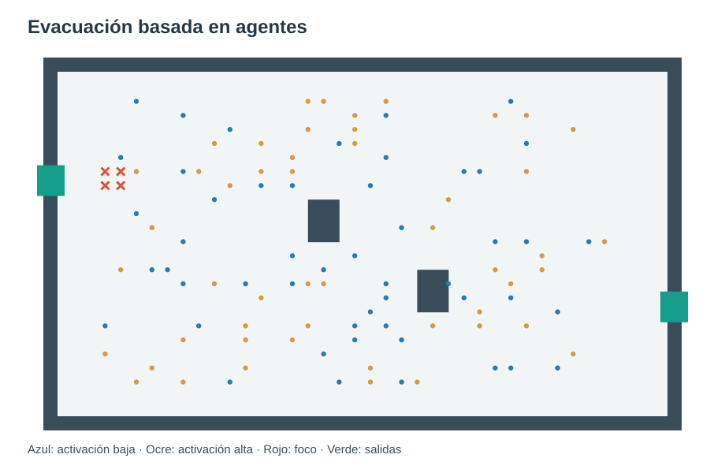
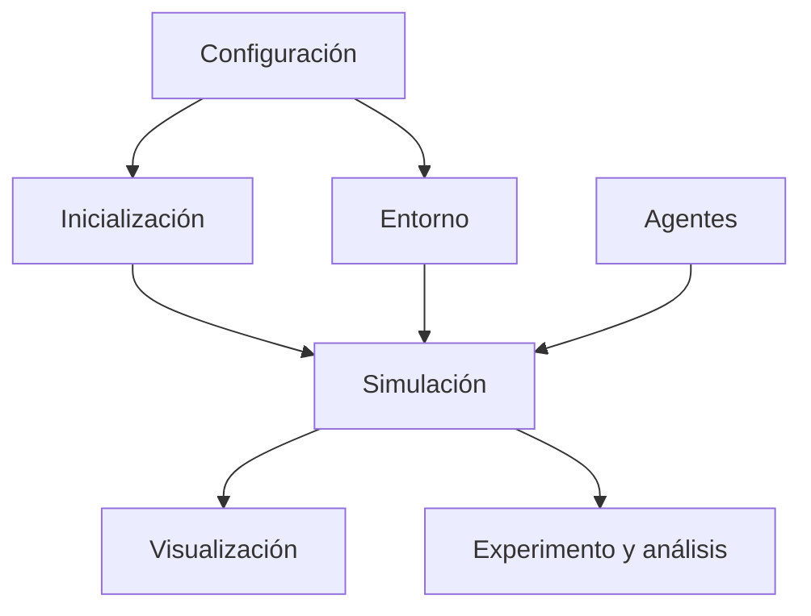

# Práctico de Modelos Basados en Agentes — Evacuación

**Cátedra Modelos y Simulación** 
**Facultad de Ingeniería y Ciencias Hídricas (FICH)** 
**Universidad Nacional del Litoral (UNL)**

Este repositorio contiene el material del **trabajo práctico sobre Modelos basados en agentes (ABM)**. El objetivo es implementar un modelo de evacuación de personas en un recinto con obstáculos, salidas y propagación de humo, y analizar cómo las interacciones individuales generan comportamientos colectivos.

## Pregunta de investigación

¿Cómo varían los resultados de la evacuación al aumentar la población inicial de **80 a 250 personas** y al utilizar un esquema de actualización **síncrono** o **asíncrono**?

Los agentes tienen activación **alta** (probabilidad 1,0) o **baja** (probabilidad 0,7); en ambos casos, pueden avanzar como máximo una celda por paso.

## Organización

| Elemento | Función |
|---|---|
| `modelo/` | Clases y funciones del modelo; contiene los métodos a implementar |
| `visualizacion/` | Gráficos y animaciones, ya implementados |
| `notebooks/` | Notebooks de prueba progresiva (`01` a `05`) y notebook del experimento (`05`) |
| [`CONSIGNA.md`](CONSIGNA.md) | Actividades, reglas, evaluación y entrega |

## Cómo comenzar

1. Abrí la **carpeta raíz del repositorio** como workspace en VS Code.
2. Seleccioná un intérprete Python e instalá las dependencias con `pip install -r requirements.txt`.
3. Empezá por `notebooks/01_escenario.ipynb`: permite visualizar el escenario sin completar ningún método.
4. Completá los métodos marcados con `TODO` en los archivos de `modelo/`. Después de cada etapa, ejecutá su notebook (`02_humo`, `03_distancias_bfs`, `04_agentes` y `05_simulacion`) para **probar el código implementado** mediante gráficos y comprobaciones `assert`.
5. Cuando funcione el modelo integrado, realizá y presentá el experimento en `notebooks/06_experimento.ipynb`.

Las notebooks `01` a `05` son guías de comprobación progresiva: no es necesario resolver los métodos dentro de ellas ni entregarlas. Si una comprobación falla, revisá el método correspondiente en `modelo/` y volvé a ejecutar la etapa. Al ejecutar un método pendiente aparecerá `NotImplementedError`, lo que indica que todavía falta implementarlo.

## Entrega

Se entrega **una sola notebook de resultados y análisis**, `notebooks/06_experimento.ipynb`, ejecutada y con gráficos, interpretación, limitaciones y conclusiones. Debe acompañarse de los módulos `modelo/agente.py`, `modelo/entorno.py` y `modelo/simulacion.py` completos para poder reproducir la ejecución.

Consultá la [consigna completa](CONSIGNA.md).

---

**Alcance:** modelo académico didáctico. No ha sido calibrado ni validado para predecir evacuaciones reales. El tiempo se expresa en pasos y las distancias en celdas.
